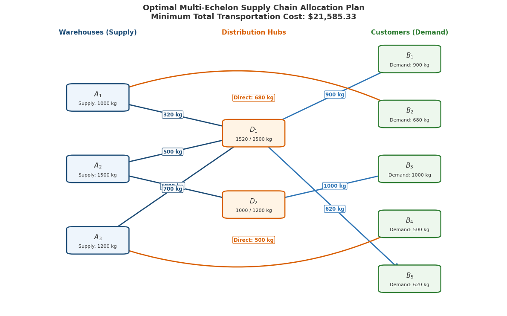

# fuzzy-supply-chain-optimization
# Multi-Echelon Supply Chain Cost Optimization (Python & Linear Programming)

## 📌 Project Overview
In real-world logistics and parcel distribution networks, supply capacities, customer demand, and lane rates fluctuate due to seasonality, customs queues, and fuel surcharges. This project implements a **Linear Programming (LP)** optimization model in Python to minimize total transportation costs across a multi-echelon network (**Warehouses → Distribution Centers → Customers**, including **Direct Shipping** options) under uncertainty.

## 🧠 Methodology & Technical Stack
* **Uncertainty Modeling (Fuzzy Logic)**: Input parameters (warehouse supply, regional demand, hub throughput capacities, and unit freight costs) are modeled as **Triangular Fuzzy Numbers (TFNs)** $(a, b, c)$ and converted into crisp equivalents via centroid defuzzification.
* **Optimal Routing Pre-Selection**: Evaluates multi-hop paths via Distribution Centers (`D1`, `D2`) against direct lanes to select the lowest-cost feasible routing per origin-destination pair.
* **Linear Optimization (`SciPy` + `NumPy`)**: Formulates equality constraints (supply/demand flow balance) and inequality constraints (distribution hub throughput limits) solved via the **HiGHS** solver (`scipy.optimize.linprog`).
* **Network Flow Visualization (`Matplotlib`)**: Automatically generates a 3-tier directed supply chain diagram displaying exact allocated cargo volumes (kg) across hub-routed and direct lanes.

## 📊 Optimal Allocation Network


## 🚀 How to Run
```bash
pip install -r requirements.txt
python fuzzy_supply_chain_optimization.py
